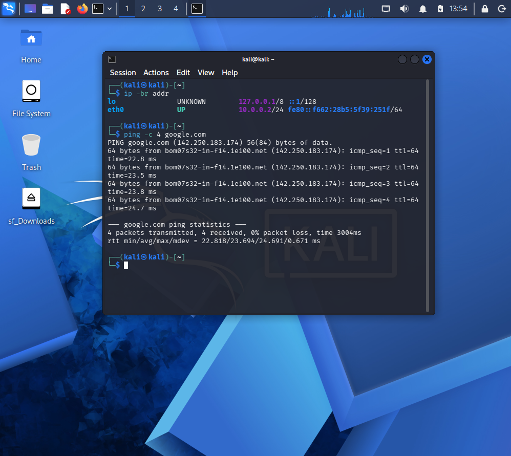
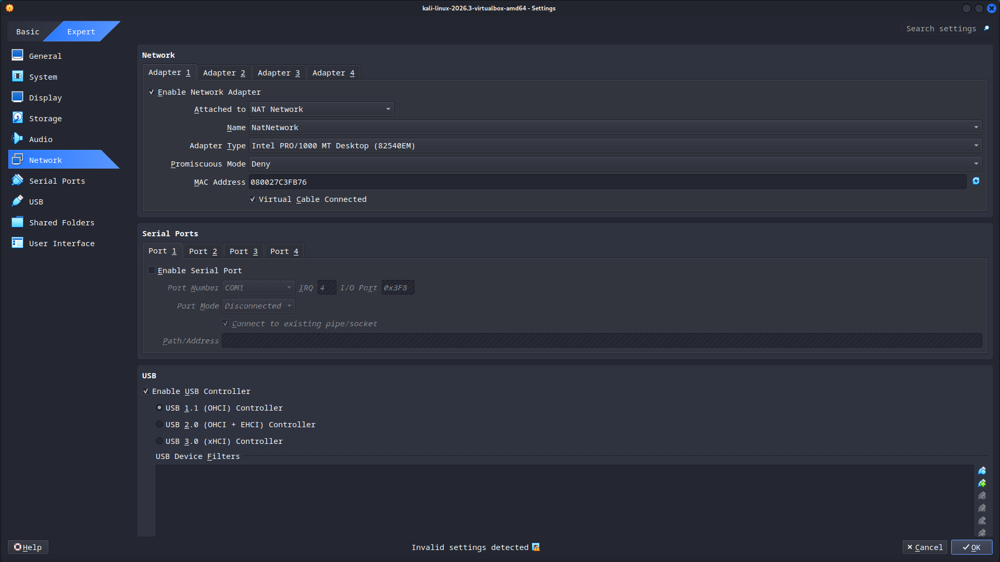
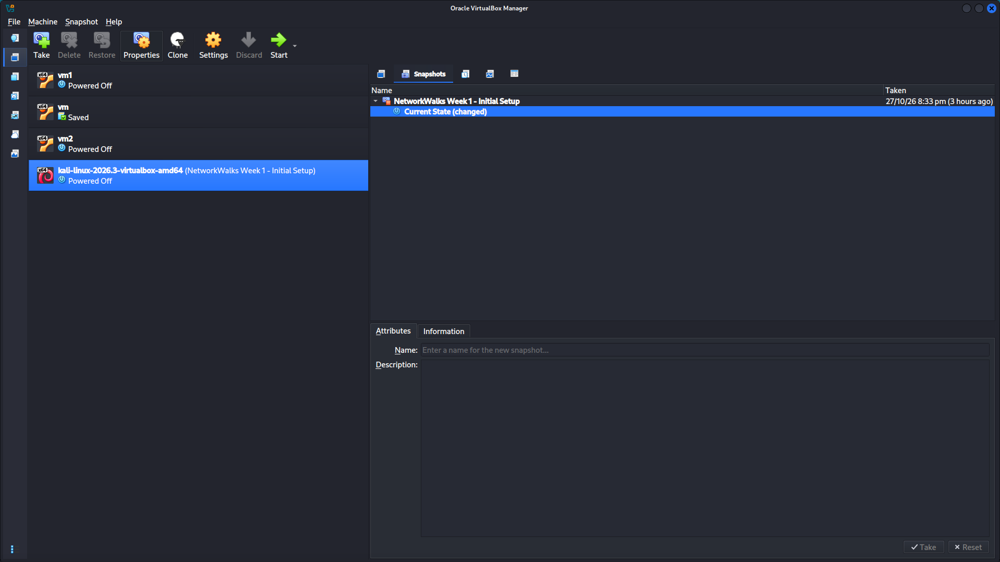
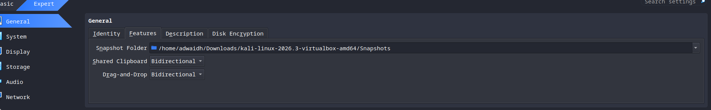
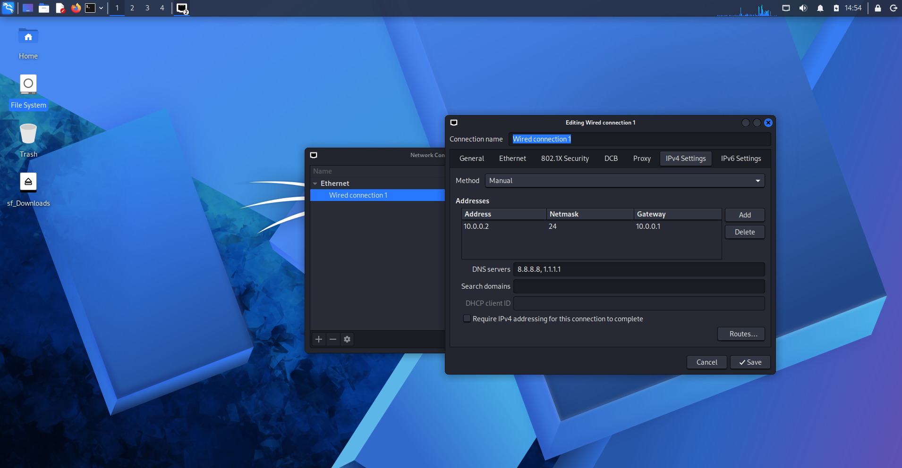

# NetworkWalks Week 1 – Cybersecurity Lab Setup

## Overview

This repository documents my Week 1 cybersecurity lab setup using Oracle VirtualBox and Kali Linux as part of the NetworkWalks program.

The goal was to configure a virtual lab environment, establish network connectivity, enable host–VM file sharing, and create a snapshot for recovery.

## Lab Environment

| Component | Configuration |
|---|---|
| Hypervisor | Oracle VirtualBox |
| Operating System | Kali Linux 2026.3 |
| Network Mode | NAT Network |
| Network Subnet | `10.0.0.0/24` |
| Kali Linux IP | `10.0.0.2/24` |
| Default Gateway | `10.0.0.1` |
| DNS Servers | `8.8.8.8`, `1.1.1.1` |
| Shared Folder | Host Downloads folder |
| Shared Clipboard | Bidirectional |
| Drag and Drop | Bidirectional |
| Snapshot | NetworkWalks Week 1 - Initial Setup |

## Tasks Completed

- Set up the Kali Linux virtual machine in VirtualBox.
- Configured a NAT Network for the lab environment.
- Assigned a static IPv4 address to Kali Linux.
- Verified internet connectivity using `ping`.
- Configured a shared folder between the host and virtual machine.
- Enabled bidirectional shared clipboard and drag-and-drop.
- Created a VirtualBox snapshot to preserve the initial lab configuration.

## Screenshots and Evidence

### 1. Kali Linux IP Address and Internet Connectivity

### 2. VirtualBox Network Configuration

### 3. Shared Folder and Snapshot

### 4. Shared Clipboard and Drag-and-Drop

### 5. Kali Linux IPv4 Settings

## Learning Outcomes

- Gained practical experience with VirtualBox and Kali Linux.
- Learned to configure a virtual network and static IPv4 settings.
- Practiced basic network connectivity verification.
- Configured file sharing between the host and virtual machine.
- Learned the importance of snapshots for lab recovery.

## Conclusion

Successfully configured the initial Kali Linux cybersecurity lab environment and documented the setup with screenshots. This environment provides a foundation for further networking and cybersecurity practical exercises.

---

**Program:** NetworkWalks  
**Week:** 1 – Lab Setup
